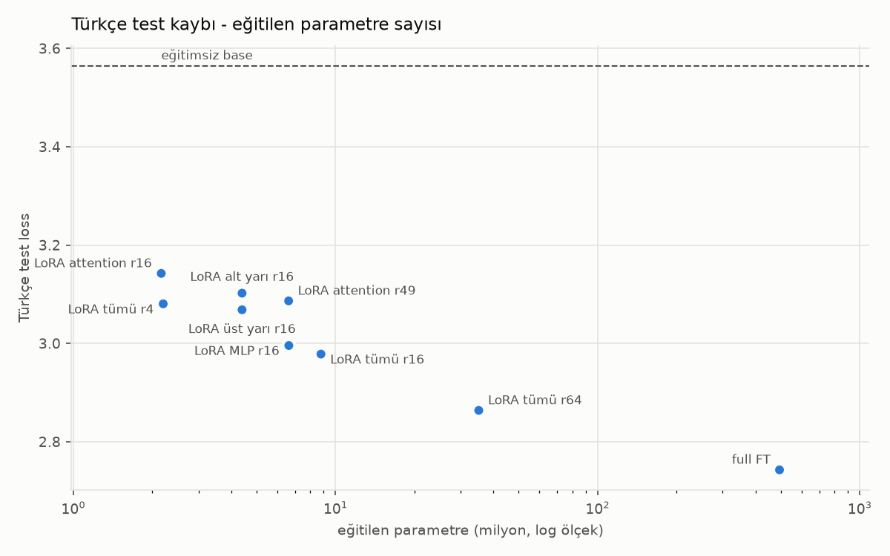
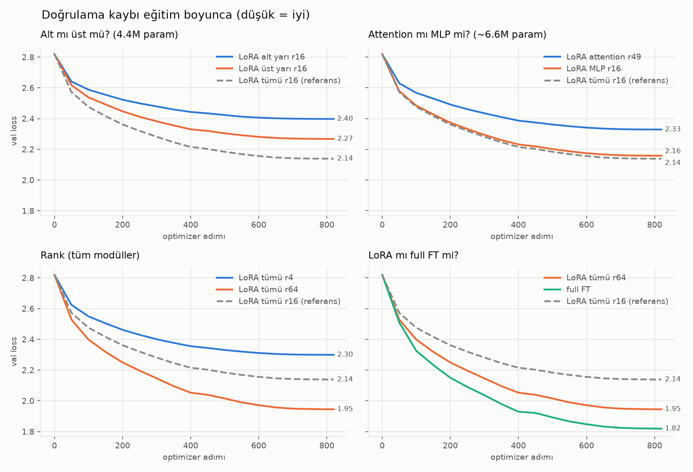
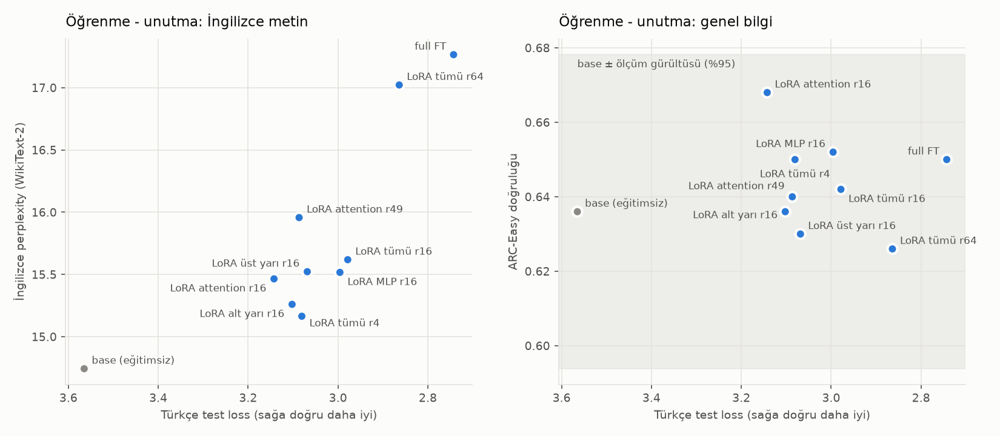
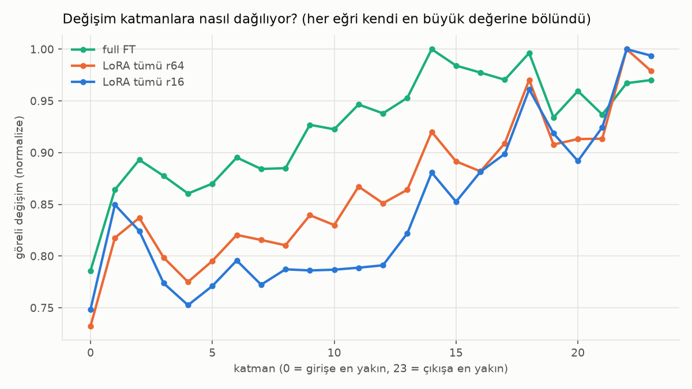
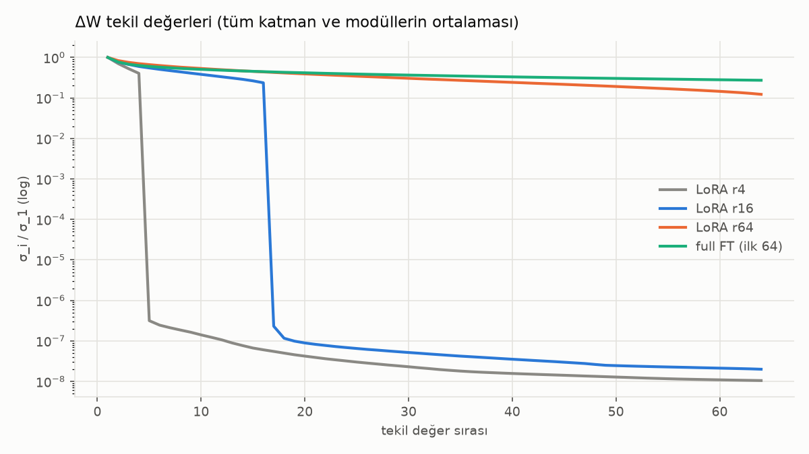
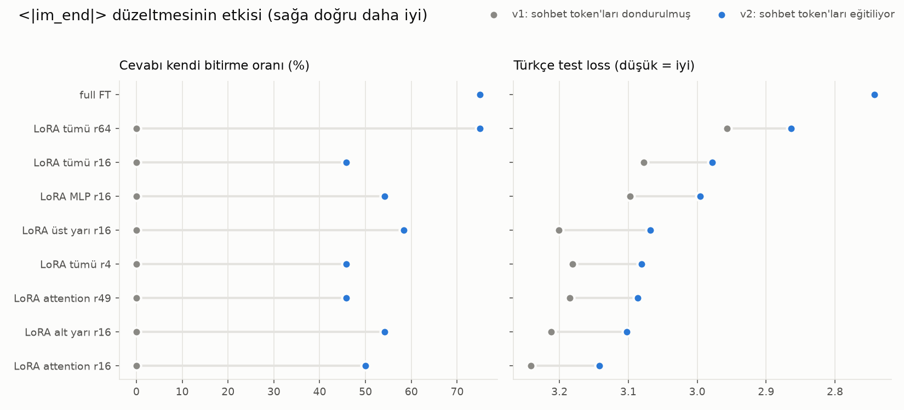

# Türkçe küçük modellerde LoRA'yı nereye koymalı?

**Performans, unutma ve öğrenmenin nerede gerçekleştiği — Qwen2.5-0.5B üzerinde kontrollü bir deney**

*Where should LoRA go? A controlled ablation of LoRA placement and rank for Turkish instruction tuning of a small model.*

🤗 [Hugging Face koleksiyonu](https://huggingface.co/collections/ayse-solmaz/turkish-lora-placement-study-6ada38f915d1e48957badcb6) ·
[8 LoRA adapter'ı](https://huggingface.co/ayse-solmaz/qwen2.5-0.5b-tr-lora-placement) ·
[full fine-tuning modeli](https://huggingface.co/ayse-solmaz/qwen2.5-0.5b-tr-sft) ·
[Kaggle koşusu](https://www.kaggle.com/code/aysenursolmaz/notebook374e74e088)

Aynı base model, aynı veri (6.5 bin Türkçe talimat), aynı adım sayısı ve seed. Deneyler arasında
değişen tek şey **LoRA'nın modelin neresine konduğu ve rank'i**. Her deney için Türkçe başarı,
İngilizcenin ne kadar unutulduğu, cevap davranışı ve ağırlıkların nerede değiştiği ölçüldü.

## Öne çıkan bulgular

> Tek seed (42) ile elde edildi; kesin sonuç değil, güçlü işaretler olarak okunmalı.

1. **MLP, attention'dan iyi.** Parametre sayısı eşitken (~6.6M) Türkçe test kaybı MLP'de 2.996, attention'da 3.086.
2. **Üst katmanlar, alt katmanlardan iyi.** Eşit bütçeyle (4.4M) 3.068'e karşı 3.102. Ağırlık analizi de aynı yönde: full fine-tuning bile en çok çıkışa yakın katmanları değiştiriyor.
3. **Yeni bir dil öğretirken rank çok önemli.** r4 → r16 → r64: 3.080 → 2.978 → 2.864. Adapter'lar verilen rank'in büyük kısmını gerçekten kullanıyor (etkin rank 3.2/4, 11/16, 36/64). Full fine-tuning'in yaptığı değişikliğin etkin rank'i ise ~279: bu görevde değişiklik *düşük ranklı değil*. LoRA'nın full FT'ye yetişememesinin muhtemel sebebi bu.
4. **Aynı bütçeyi yaymak daha verimli.** Tüm modüllere r4 (2.2M parametre), sadece attention'a r49'un (6.6M) yaptığını 3 kat daha az parametreyle yapıyor.
5. **LoRA daha az unutuyor.** İngilizce perplexity: base 14.7 → LoRA r16 15.6 → full FT 17.3.
6. **Beklenmedik bir hata buldum ve düzelttim.** Qwen2.5 base'de `<|im_end|>` token'ı eğitilmemiş. Bu yüzden ilk koşudaki LoRA modelleri cevaplarını **hiç bitiremedi**. Ayrıntılar [aşağıda](#bulunan-hata-eğitilmemiş-sohbet-tokenları).



## Deneyler

Qwen2.5-0.5B'de 24 katman var. Her katmanda bir attention bloğu (`q, k, v, o`) ve bir MLP bloğu
(`gate, up, down`) bulunuyor; parametrelerin %64'ü MLP'de.

| deney | katmanlar | modüller | rank | eğitilen param |
|---|---|---|---:|---:|
| `lora_all_r16` (referans) | 24'ü de | attention + MLP | 16 | 8.80M |
| `lora_lower_r16` | 0–11 | attention + MLP | 16 | 4.40M |
| `lora_upper_r16` | 12–23 | attention + MLP | 16 | 4.40M |
| `lora_attn_r16` | 24'ü de | attention | 16 | 2.16M |
| `lora_attn_r49` | 24'ü de | attention | 49 | 6.63M |
| `lora_mlp_r16` | 24'ü de | MLP | 16 | 6.64M |
| `lora_all_r4` | 24'ü de | attention + MLP | 4 | 2.20M |
| `lora_all_r64` | 24'ü de | attention + MLP | 64 | 35.19M |
| `full_ft` | hepsi | her şey | – | 494M |

`lora_attn_r49`, parametre sayısını `lora_mlp_r16` ile eşitlemek için var. Aynı rank'te MLP ~3 kat
fazla parametre eğittiği için, eşitleme yapılmazsa "MLP daha iyi" sonucu sadece "daha çok
parametre" anlamına gelebilirdi.

## Sonuçlar

| deney | param | TR test loss ↓ | EN ppl ↓ | ARC-Easy | cevabı bitirme | tekrar ↓ | süre (T4) | bellek |
|---|---:|---:|---:|---:|---:|---:|---:|---:|
| full FT | 494M | **2.743** | 17.27 | 0.650 | 75% | 0.22 | 47 dk | 12.0 GB |
| LoRA tümü r64 | 35.2M | 2.864 | 17.02 | 0.626 | 75% | 0.11 | 59 dk | 6.5 GB |
| LoRA tümü r16 | 8.8M | 2.978 | 15.62 | 0.642 | 46% | 0.35 | 60 dk | 6.1 GB |
| LoRA MLP r16 | 6.6M | 2.996 | 15.52 | 0.652 | 54% | 0.31 | 49 dk | 6.0 GB |
| LoRA üst yarı r16 | 4.4M | 3.068 | 15.52 | 0.630 | 58% | 0.31 | 47 dk | 6.0 GB |
| LoRA tümü r4 | 2.2M | 3.080 | 15.16 | 0.650 | 46% | 0.40 | 58 dk | 6.0 GB |
| LoRA attention r49 | 6.6M | 3.086 | 15.96 | 0.640 | 46% | 0.33 | 46 dk | 6.0 GB |
| LoRA alt yarı r16 | 4.4M | 3.102 | 15.26 | 0.636 | 54% | 0.33 | 48 dk | 6.0 GB |
| LoRA attention r16 | 2.2M | 3.142 | 15.46 | 0.668 | 50% | 0.33 | 46 dk | 6.0 GB |
| base (eğitimsiz) | 0 | 3.565 | 14.74 | 0.636 | 0% | 0.75 | – | – |

- **TR test loss:** Aya Türkçe test bölümü (250 insan yazımı örnek, eğitimde hiç görülmedi), sadece cevap token'ları.
- **EN ppl:** WikiText-2 perplexity; artış = İngilizcenin unutulması.
- **ARC-Easy:** 500 soru. ±4 puan ölçüm gürültüsü sınırında; buradaki farkların hiçbiri anlamlı değil.
- **Cevabı bitirme / tekrar:** 24 sabit prompta greedy üretim (en fazla 256 token).
- Tüm tablo, dil kayması ve talimat uyumu sütunlarıyla: [results/summary.md](results/summary.md). Örnek cevaplar: [results/samples.md](results/samples.md).





**Bellek ve süre üzerine bir not:** LoRA belleği yarıya indiriyor (6 GB ve 12 GB), ama bu boyuttaki
bir modelde eğitimi hızlandırmıyor. İleri ve geri geçiş yine bütün modelden geçiyor; LoRA'nın ek
matrisleri de her adımda ek hesap getiriyor.

## Öğrenme nerede oldu? (ağırlık analizi)

Her lineer katman için değişim matrisi ΔW hesaplandı: full FT'de ağırlık farkı, LoRA'da `(α/r)·B·A`.
Kod: [src/weight_analysis.py](src/weight_analysis.py) · tablo: [results/weights/weights.md](results/weights/weights.md).

| | alt yarı / üst yarı | attention / MLP | etkin rank (%90 enerji) |
|---|---|---|---|
| full FT | 1.68% / **1.84%** | 1.67% / **1.88%** | **279** |
| LoRA r64 | 5.15% / **5.82%** | 5.36% / **5.66%** | 36 / 64 |
| LoRA r16 | 3.20% / **3.67%** | 3.22% / **3.72%** | 11 / 16 |
| LoRA r4 | 1.92% / **2.25%** | 1.90% / **2.34%** | 3.2 / 4 |

(Değerler göreli değişim, ‖ΔW‖/‖W‖. LoRA'nın öğrenme oranı 10 kat yüksek olduğu için LoRA ile full
FT'nin mutlak büyüklükleri karşılaştırılamaz; sadece *dağılımları* karşılaştırılabilir.)





LoRA r64'ün ilk 64 tekil değeri, full FT'ninkiyle neredeyse aynı eğriyi izliyor. Yani r64, full
FT'nin değişikliğinin en önemli 64 yönünü yakalıyor, ama gerisini kaçırıyor. Full FT ısı
haritasında ise en çok değişen ağırlıklar ilk 3 katmanın `v_proj`'u, aynı katmanların `q_proj` ve
`k_proj`'u neredeyse hiç değişmiyor: [heatmap_full_ft.png](results/weights/heatmap_full_ft.png).

## Bulunan hata: eğitilmemiş sohbet token'ları

İlk koşuda (v1) LoRA modelleri cevaplarını **hiç bitiremedi** (%0); full FT ise %75 oranında
bitirebildi. Sebebi şuydu: Qwen2.5-0.5B **base**'de `<|im_start|>` ve `<|im_end|>` embedding
satırları eğitilmemiş, yani ~290 kullanılmayan token'ın satırıyla **birebir aynı**. Embedding ile
çıkış katmanı paylaşımlı olduğu için, embedding'i dondurulmuş bir LoRA `<|im_end|>`'in olasılığını
bu ikizlerinin üstüne hiçbir zaman çıkaramaz. Full FT ise embedding'i de eğittiği için sorunu
yaşamadı.

Düzeltme (v2): LoRA'da sadece bu iki satırı da eğitmek (PEFT `trainable_token_indices`, +1,792
parametre). Bütün LoRA modelleri cevaplarını bitirmeye başladı, test kaybı ~0.1 iyileşti, deneyler
arasındaki sıralama ise değişmedi.



v1 sonuçları ve açıklaması: [results/v1_frozen_chat_tokens/](results/v1_frozen_chat_tokens/).
Bir başka tuzak da şuydu: T4'te `torch.cuda.is_bf16_supported()` `True` dönüyor, ama bf16 yazılımla
taklit ediliyor ve ~3.5 kat daha yavaş. Bu yüzden kod T4'te fp16 seçiyor ([pilot koşu](results/pilot_bf16/)).

## Kurulum

**Veri:** [Aya dataset](https://huggingface.co/datasets/CohereLabs/aya_dataset) Türkçe kısmı (insan yazımı, Apache-2.0)
ve [GPT-4-Self-Instruct-Turkish](https://huggingface.co/datasets/CausalLM/GPT-4-Self-Instruct-Turkish) (CC-BY-4.0).
Tekrarlar ve 1024 token'dan uzun örnekler atıldı: 6,573 train, 300 val. Test için Aya'nın kendi test bölümü kullanıldı.

**Eğitim:** Qwen2.5-0.5B base · Qwen chat template · loss sadece cevap token'larında · 2 epoch (822 adım) ·
efektif batch 16 · AdamW, lr 2e-4 (LoRA) / 2e-5 (full) · cosine, %3 warmup · α = 2·rank, dropout 0.05 ·
fp16 karışık hassasiyet · gradient checkpointing · Kaggle 2×T4 (iki deney paralel).

## Tekrar üretme

**Kaggle** (yeni notebook, **GPU T4 x2**, **Internet On**). Tek hücre ile 9 deneyi eğitir ve
değerlendirir, ~4.5 saat sürer:

```
!git clone https://github.com/ayse-solmaz/turkish-lora-layers.git && cd turkish-lora-layers && bash scripts/kaggle_run.sh
```

Sonunda `eval_bundle.zip` üretilir. Grafikler ve analiz yerelde, CPU ile:

```bash
uv venv --python 3.11
uv pip install -r requirements.txt
python src/plots.py --bundle results/bundle_seed42 --compare results/v1_frozen_chat_tokens/bundle_seed42
python src/weight_analysis.py --runs_dir <kaggle çıktısındaki outputs/seed42>
```

## Proje yapısı

```
src/
  prepare_data.py      veri indirme, temizleme, train/val/test
  data.py              chat template + label masking
  experiments.py       9 deneyin tanımı
  train.py             LoRA / full fine-tuning eğitimi
  evaluate.py          test loss, unutma, örnek cevaplar, davranış ölçümleri
  plots.py             grafikler ve özet tablolar
  weight_analysis.py   ΔW: katman dağılımı ve etkin rank
  prompts.py           sabit değerlendirme promptları
scripts/
  inspect_model.py     model yapısı ve parametre sayıları
  kaggle_run.sh        Kaggle'da eğitim + değerlendirme
  kaggle_eval.sh       sadece değerlendirme (eğitilmiş modeller Input olarak eklenmişse)
  run_all.sh           deneyleri sırayla eğitir
  prepare_hf.py        Hugging Face repolarını hazırlar
results/               tablolar, grafikler, v1 arşivi, pilot koşu
```

## Sınırlamalar ve sonraki adımlar

- **Tek seed.** Yakın sonuçlar (ör. üst ve alt yarı arasındaki 0.03 fark) tesadüf olabilir. Sıradaki adım seed 43 ve 44.
- **Tek öğrenme oranı.** Bütün LoRA'lar lr 2e-4 ile eğitildi; her rank için ayrı ayar yapmak sonuçları değiştirebilir.
- **Küçük model, az veri.** 0.5B model halüsinasyon görüyor ve cevapların yaklaşık yarısında duramıyor. Modeller araştırma çıktısıdır.
- **Ölçümler basit.** Dil kayması ve talimat uyumu, 24 prompt üzerinde sezgisel kurallarla ölçüldü.
